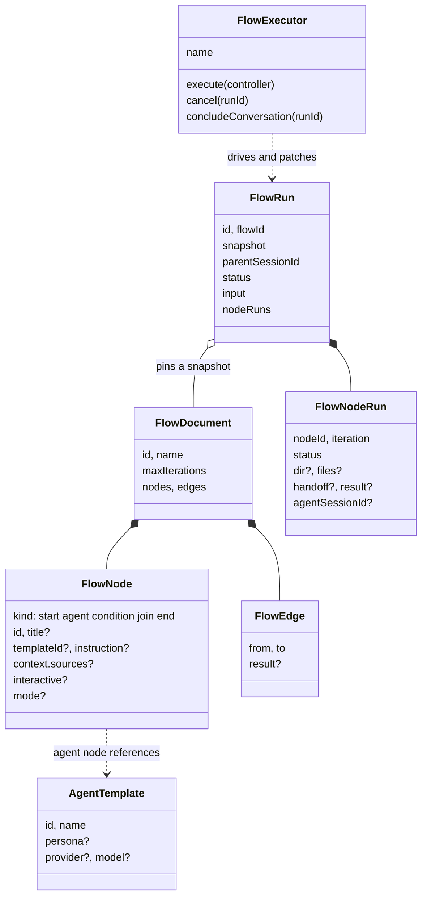
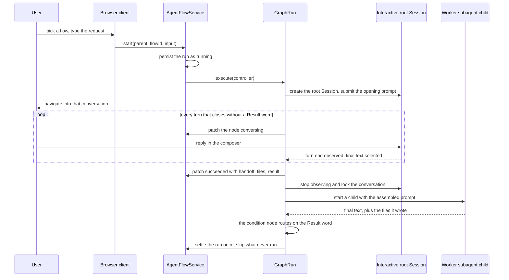
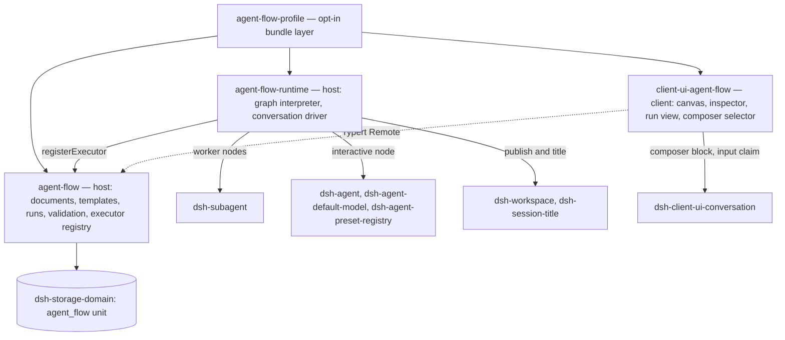
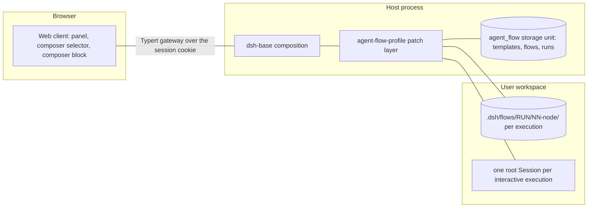

# Agent Note: Agent Flow design — chat-group workflows with file handoff

Status: proposed

> **Current authority (2026-10-21 review decision).** The final graph vocabulary differs from parts of this original proposal: each relation persists an explicit `execution` or `input` kind; only `all` joins exist; the original user request requires an explicit input edge from start; execution edges hand off their source result; and only serial review loops — one agent entry and one conditional return — are admitted, with parallel merges inside a loop rejected. The [Agent Flow subsystem reference](../../../../docs/subsystems/agent-flow.md) owns the current contract. Field sketches and paragraphs below that predate this decision remain as the original proposal.

English | [中文](2026-10-10-agent-flow-design.zh.md)

## Problem

Users need fixed multi-agent workflows: agent types they author once, wired into a flowchart whose routing they control, executed repeatedly. The M1–M4 skeleton ([the seams note](../../implemented/architecture/2026-09-24-agent-flow-plugin-seams.md), which owns the package-topology decisions) proved the seam but shipped a handoff model that pushes format and wiring work onto the user: per-template `outputSchema`, hand-written node prompt templates with `{{…}}` placeholders, JSON-path branch conditions, an acyclic graph that outlaws review loops, and runs that start from named variables. Nothing a node produces survives as a document.

The user model is a chat group whose members respond in a fixed order. An agent consumes two optional inputs — the user's opening message and the upstream handoff — and hands work off the way engineers do: write documents, leave a handoff note, point the next agent at the files. A review flow loops until the reviewer passes.

## Proposal

Ship the complete workflow system in the four experimental packages the seams note established: `agent-flow` (documents and runs over a storage domain), `agent-flow-runtime` (the `graph` executor), `client-ui-agent-flow` (the Web panel), and `agent-flow-profile` (the opt-in bundle). The sections below are the full target design: features, data model, runtime semantics, user interface, constraints, and accepted limitations. M1–M4 delivered the skeleton; M5 replaces the handoff model per this design in three steps (M5a data and runtime, M5b panel, M5c chat-control selector).

## Features

**Agents.** The panel's Agents page lists every agent with the number of flows referencing it, prompts creation when none exist, and edits one agent per form: name, persona, and a model route picked from the system's configured catalog (no free text, no default). A saved route that later leaves the catalog stays selectable, so editing never rewrites it. Agents run with the system's default tools; per-agent scoping is not restricted for now.

**Flows.** The canvas edits one directed graph per flow: `start`, `agent`, `condition`, `join`, and `end` nodes, connected by dragging. An agent node names its template and carries an `instruction` plus a `context` choosing which upstream handoffs it reads, defaulting to the direct predecessors; the user's message joins it exactly when an edge arrives from `start`. Every outgoing edge of a condition node carries one routing word. Save-time validation rejects the whole graph at once with every problem: single start and end, full connectivity, an entry node start feeds with no other unconditional predecessor, acyclic unconditional edges, condition nodes fed by exactly one agent node and carrying a distinct word on every outgoing edge, at most one condition node per agent feed, joins with at least two incoming edges, and resolvable context sources.

**Runs.** A run starts from the chat page: the workflow selector in the session composer's bottom-left tool row — beside the '+' menu and the permission-model selector — applies to the current session, and sending a message while a workflow is selected starts a run with that message as input. A run stays cancellable. The run view renders as a chat record: one message per node execution showing the agent's name, its handoff note, openable links to the files it produced, and its status. The list refreshes while a run is in flight.

**Handoff.** Each agent node execution owns a workspace directory and writes its documents there. The runtime derives the durable record from the filesystem and the agent's final message; downstream agents receive the handoff note and file paths and read what they need.

**Branching and loops.** A condition node routes on the `Result: <word>` line of the one agent node feeding it: the runtime matches the word exactly against the condition node's outgoing edges and activates the match. Every outgoing edge of a condition node carries a word, and a missing or out-of-vocabulary line fails the agent that produced it loudly. A condition node produces no content of its own and forwards that agent's handoff to its targets, so a route back into a loop still carries the verdict that chose it. Cycles are admitted when they pass at least one condition node, so review loops run until the reviewer passes; a flow-level iteration cap bounds the loop.

## Data model

`FlowId`, `AgentTemplateId`, and `FlowRunId` stay random globally-unique branded strings, and a run binds the complete flow document it started from.

```ts ignore-check
/** One reusable agent definition. */
interface AgentTemplate {
  readonly id: AgentTemplateId
  readonly name: string
  readonly persona?: string
  readonly provider?: string
  readonly model?: string
}

/** One directed workflow graph; every cycle must pass a condition node. */
interface FlowDocument {
  readonly id: FlowId
  readonly name: string
  /** Bound on total agent-node executions per run; validated, default 16. */
  readonly maxIterations: number
  readonly nodes: FlowNode[]
  readonly edges: FlowEdge[]
}

type FlowNode =
  | { readonly kind: 'start'; readonly id: string }
  | {
      readonly kind: 'agent'
      readonly id: string
      readonly title?: string
      readonly templateId: AgentTemplateId
      /** What this step does; the runtime assembles the full prompt. */
      readonly instruction: string
      /** Handoff selection; defaults to the direct predecessors. */
      readonly context?: { readonly sources?: string[] }
    }
  | { readonly kind: 'join'; readonly id: string; readonly mode: 'all' | 'any' }
  | { readonly kind: 'condition'; readonly id: string }
  | { readonly kind: 'end'; readonly id: string }

interface FlowEdge {
  readonly from: string
  readonly to: string
  /** Routing word of one condition-node outgoing edge; absent on every other edge. */
  readonly result?: string
}

/** One run of a flow, started from one user message. */
interface FlowRun {
  readonly id: FlowRunId
  readonly flowId: FlowId
  readonly snapshot: FlowDocument
  readonly parentSessionId: SessionId
  readonly status: 'running' | 'completed' | 'failed' | 'cancelled'
  readonly input: string
  readonly nodeRuns: FlowNodeRun[]
  readonly startedAt: string
  readonly finishedAt?: string
  readonly error?: string
}

/** One execution of one node; an agent node re-executing in a loop adds entries. */
interface FlowNodeRun {
  readonly nodeId: string
  readonly iteration: number
  readonly status: 'pending' | 'running' | 'succeeded' | 'failed' | 'skipped'
  readonly agentSessionId?: SessionId
  /** Workspace directory this execution wrote into. */
  readonly dir?: string
  /** Files found in `dir` after the node settled; derived, never declared. */
  readonly files?: string[]
  /** The agent's final message. */
  readonly handoff?: string
  /** The Result word an agent emitted, or the one a condition node routed on. */
  readonly result?: string
  readonly error?: string
}
```

## Runtime semantics

**Scheduling.** The executor walks the graph: ready nodes run with bounded concurrency, a condition node activates the outgoing edge whose word matches the Result line of the agent feeding it, a join waits for `all` arrivals or proceeds on `any`, and unreachable nodes settle `skipped`. Start activates only its entry nodes — those with no unconditional predecessor besides start itself, where a condition node's selective edge never counts — so its remaining edges merely mark their targets as reading the user message without running them ahead of the predecessors that order them. A cycle re-executes its nodes with an incrementing iteration number until a condition routes out or the run reaches `maxIterations`, which fails the run with the last recorded result.

**Fixed prompt assembly.** Node prompts are runtime-rendered, never user-templated: the instruction; the user's message when an edge arrives from `start`; one section per source node carrying its handoff note and absolute file list, never file contents, where a condition predecessor contributes the handoff of the agent feeding it; the node's own output directory; and, when the node feeds a condition node, one line requiring the final message to end with `Result: <word>` using one of the words collected from that condition node's outgoing edges.

**File handoff.** Each agent node execution owns `.dsh/flows/<runId>/NN-<nodeId>/` inside the workspace, where NN is the iteration number. The runtime creates the directory before the node starts, and after the node settles scans it into `files` and stores the final assistant text as `handoff`. The Result line is parsed from the handoff's last line; a missing or out-of-vocabulary line fails the node loudly, naming the expected words.

**Node agents.** A template still maps onto the subagent seam's start-time options (persona and model route), so node execution is the runtime's `ctx.subagents.start()` call in a child session of the run's parent, and the agent base is never touched. Node agents run with the system's default tools.

**Persistence and cancellation.** Records stay in the `agent_flow` storage-domain unit with per-record layout. A run persists in `running` state before the executor begins, settles exactly once in the background, and oldest settled runs drop beyond `maxRuns`. Only the parent session's live Agent may cancel a run; cancel aborts the in-flight node agents and is terminal. The layout changes bump the domain version, so records written by the M1–M4 build are dropped on read with no migration path; the package is experimental with no stability promise.

## User interface

The Web panel keeps three tabs. **Agents** is the default view and manages templates. **Flows** lists flows and opens the canvas editor; the inspector edits a node's instruction and context sources, and the routing word of an edge leaving a condition node. **Runs** renders each run as a chat record with file links, live status, and cancellation. Runs never start from the panel: the workflow selector in the composer's bottom-left tool row applies to the current session, and a message sent while a workflow is selected starts the run with that message as input.

## Constraints

- The agent base is not modified: no changes to agent-loop, sessions, or the subagent seam; node agents are ordinary subagent children.
- The PTC workflow engine is not displaced: one `WorkflowEngine` provider per context, and Agent Flow is a separate service.
- No model-facing surface: the system registers no tool, injects no prompt into user sessions, and appends no session events, so the model-visible-means-logged invariant is not triggered and no `SessionEventMap` or SDK change follows. Run detail lives in the storage domain, not the session log.
- Every package is experimental and public with no stability promise; users opt in through the `agent-flow-profile` bundle.
- No separate entry point is added: starting a run rides the composer's bottom-left tool row, the same surface that holds the '+' menu and the permission-model selector.
- Deployment-varying limits (`maxRuns`, `maxIterations`) are validated configuration, not hardcoded constants.
- Artifacts live in the user's workspace, visible and user-modifiable.

## Limitations

- Cancellation is terminal; resume from a failed node is deferred, and the iteration-numbered record leaves room for it.
- Run progress polls on an interval instead of streaming.
- Cycles must pass through a condition node; join semantics inside a cycle are undefined and documented, not handled.
- Result routing depends on model compliance; failure is loud but burns iterations.
- Deep flows with many sources grow prompts; the direct-predecessor default keeps the bound local and content never travels inline.
- Run progress and chat records live in the panel; messages and results do not stream back into the session's own chat view.
- Fuzzy routing (an LLM judging a natural-language condition) is not available; only exact Result words route.
- The domain version bump discards M1–M4 flows, templates, and runs.

## Delivery plan

M1–M4 (shipped): the service seam, the graph executor, the panel, and the bundle. M5a replaces the handoff model in the data types and runtime — instruction and context replace `prompt`, file directories and derived records replace `outputSchema` and interpolation, Result routing replaces JSON-path conditions, and cycles with the iteration cap arrive. M5b reshapes the panel: the chat-record run view and the simplified editors, with the launcher removed. M5c adds the workflow selector to the composer's bottom-left tool row through the `conversation.input.left` slot. M6 moves routing off agent-node edges onto condition nodes and derives the user message from `start` edges, after a live end-to-end run of a design→implement→review flow showed both the hidden per-node input flag and the decision-as-edge-property to be unreadable on the canvas.

## Alternatives considered

The seams note owns the platform-level alternatives — a second `WorkflowEngine` provider, extending Agent Teams, authoring flows as preset YAML, and journaling runs as session events — and this design keeps those rejections. The handoff-model alternatives:

**LLM-judged branch conditions.** A judge tolerates fuzzy wording, but it adds cost and latency to every routing decision, is nondeterministic under replay, and cannot be tested without a model. The Result convention is deterministic, persisted, and free; a judge can return later as a second condition kind if genuinely fuzzy routing appears.

**Routing words on the deciding agent's own outgoing edges.** That shape saves one node per decision, but it hides the branch in an edge property: the canvas shows an agent whose outgoing edges silently disagree about whether it decides anything, the agent's outgoing-edge set must be all-worded or all-plain so one node cannot both fan out and branch, and a decision combining several upstream verdicts has nowhere to live. A condition node makes the decision a visible graph citizen, keeps an agent node to one job, and costs nothing at run time because the node resolves instantly.

**A per-node flag for the user message.** A boolean on the agent node works, but it is invisible on the canvas and duplicates what the graph already says: `start` is where the user message enters, so an edge from it is the fact. Deriving the input from that edge keeps one mechanism, at the cost of the entry rule that keeps a mid-chain start edge from running its target early.

**Keep per-template outputSchema.** It makes format authorship the user's job for every template, and the structured output exists mainly so the runtime can route — a need Result lines serve directly. Human-readable structure survives in the run record the runtime derives, not in anything the agent must produce.

**File-existence conditions.** Conditions must judge content, not presence; the verdict already lives in the handoff note, and Result lifts exactly that content into the record.

**Post workflow messages into the parent session.** That is the fullest chat-group reading, but it modifies session behavior the agent-base constraint reserves. The panel renders the chat record instead; the chat-page selector starts runs without touching message flow.

**A panel-side run launcher.** A launcher with its own flow and session pickers duplicates the composer tool row and scatters entry points. The workflow selector rides that row, and the run always binds to the current session.

**Keep named flow inputs.** Named variables belong to a form-filling launcher; the chat-group model has one opening message. Multiple inputs can return if a launch form ever needs them.

**Resume from a failed node.** Deferred rather than rejected: the iteration-numbered record and per-iteration directories already leave room, and cancel semantics stay as they are.

## Acceptance criteria

- A review loop — engineer node, reviewer node, and a condition node whose edges `Result: 通过` → end and `Result: 不通过` → engineer — starts from a message sent with the workflow selected in the composer's bottom-left tool row, iterates until the reviewer passes, and terminates; the engineer's second pass reads both the upstream design handoff and the reviewer's verdict forwarded through the condition node; a run that never passes fails at `maxIterations` with the last result recorded.
- A downstream node's prompt contains handoff notes and absolute file paths only; the files exist under the workspace directory, and a page reload still shows the complete run from storage.
- The panel renders a run as a chat record with file links; templates carry no `outputSchema`, flows carry no `inputs`, and only a condition node's outgoing edges carry a Result word.
- Save-time validation rejects a cycle with no condition node, a flow with no entry node, and an invalid `maxIterations`, listing every problem at once.
- The prompt-assembly change is model-visible, so the recorded-session snapshots that cover node prompts update in the same change; coverage stays at per-file 100 percent on the touched packages.

## Risks

- The Result line depends on model compliance. Failure is loud — the error names the expected vocabulary — but a model that ignores the instruction fails the run rather than misroutes it, and repeated failures burn iterations.
- Handoff notes are free text, and a deep flow with many sources inflates prompts; defaulting sources to direct predecessors keeps the bound local, and file content never travels inline.
- Join semantics inside cycles are undefined beyond the acyclic rules; the condition-node requirement keeps cycles out of joins, and the limitation is documented rather than handled.
- The domain version bump discards M1–M4 flows, templates, and runs with no migration path.

## Interactive nodes (M7)

**Problem.** A node agent is an owned child of the run's parent Agent, so `ask_user_question` rejects it with `DELEGATED_CALLER` ([user-questions](../../../../packages/interaction/user-questions/src/index.ts) admits only `agents.roots()`), the Web composer for a one-shot child is read-only, and every subagent messaging tool is disabled in the web profile. The first node of a real flow — a senior engineer eliciting requirements — cannot talk to the user at all.

**The distinction that resolves it.** Root versus owned child is a *runtime ownership* relation, not durable lineage: `roots()` is "created without an owning agent context… a resumed fork may still be a root" ([agent registry](../../../../packages/core/agent/src/index.ts)). A node materialized as an ordinary Session is a root: it may ask the user, and its composer is writable because the client's read-only takeover is keyed on `mode === 'one-shot'` ([ui-subagent](../../../../packages/client/ui-subagent/src/client/index.ts)).

**Decision: the conversational node runs as a root Session; worker nodes stay one-shot subagent children.** Only the first node faces the user — a worker with a doubt asks its upstream node, not the human — so two execution paths buy an explicit role split rather than incidental divergence.

- Authoring: `interactive?: boolean` on an agent node. Validation admits at most one per flow and requires it to be the flow's *only* entry node: start activates every entry at once, so a second entry would run while the user is still clarifying.
- Materialization: `ctx.agents.create({ sessionId, agentOptions: route, meta: { cwd }, setup })` — `cwd` is the run's workspace, and `route` is `agentDefaultModel.currentSelection()` under the template's provider/model overrides, dropping the inherited reasoning effort when the route changes, exactly as `resolveChildAgentOptions` does for a child. `setup` joins the run's parent composition through `agentPresets.composeFrom` and installs the route with `installModelSelection`; a root joined to no preset sees an empty tool registry in an agent-plane composition. No agent preset is *registered*: `AgentPresetRegistry.list()` publishes every registered definition to the user's mode selector with no internal flag, so a per-template preset would pollute it. The template's persona therefore rides in the assembled prompt rather than shadowing the system persona. The Session is then attached to the workspace that already holds the parent and titled after its node, so it is navigable like any other.
- Ownership: the handle is never disposed. Like a webhook-created Session, the conversation is an ordinary Session that outlives the run — disposing it would unregister the transcript the user is reading, and M7-4 needs it live to relay a sibling's question.
- Driving: `agent.followup(...)` submits the assembled prompt. Turn boundaries come from observing `session/event` for that Session and folding each event through `AssistantOutputFold`, the subagent seam's own final-output rule, recording one entry per `turn/end`; `whenIdle()` is not a per-turn signal and synchronous log reads are deprecated. `agent.cancel({ kind: 'user' })` interrupts a live turn when the run is cancelled.
- Completion is a protocol, not a lifecycle event. An interactive node stays open across user turns until its final message carries `Result: <word>`; a node that feeds no condition node uses the fixed word `done`. A turn that closes without it means the conversation continues, so the node enters `conversing` and keeps waiting. A word outside the vocabulary fails the node, as it does for a worker; a turn whose reason is `error` fails it immediately. The prompt makes the last exchange explicit: when nothing is left ambiguous the agent asks whether to start the rest of the work, and only the user's agreement ends the clarification, so downstream nodes never start on the agent's own judgement.
- Locking is real, in two layers. The client raises `ctx.conversation.blocks.set(sessionId, { reason })` for every session whose conversational node reached a terminal status — the sanctioned per-session composer block, whose reason becomes the inert input's placeholder. It is derived from the durable run roster, read once at plugin mount rather than only when the panel opens, so it survives a reload and needs no session projection. The runtime refuses what a client that never raised the block could still send: an agent-scoped `agent/pre-step` listener, installed in the conversation's `setup`, rejects any step carrying a human prompt the runtime did not submit, admitting its own messages by `MessageId`. A rejected step is silent — the claimed message never enters the log and the turn closes without a step — so the block carries the explanation and the refusal is only the backstop. A `conversation.composer` chain seat was rejected for this: its `select` must be a pure function of the owner props, so it cannot react to a plugin-owned store.
- Both lock layers are client- or process-local. The durable fact that a conversation concluded lives in the run roster, which `maxRuns` eventually evicts; a lock that survives both a restart and eviction needs a session event and its projection, which is the one route that reaches every client reactively through `SessionSnapshot`.
- Bound: `maxConversationTurns` (default 16) fails the node loudly once the dialogue uses its budget without converging. No wait timeout: the human may step away for hours, and the run stays cancellable, so an idle conversation costs a concurrency slot rather than a failed run. A dialogue that will not converge ends through `agentFlows.concludeConversation(parent, runId)`: the service forwards to the engine owning the run, the executor keeps one conversational agent per run behind a seat the conversation publishes into, and concluding submits one closing instruction to that Session and consumes the registration — so a repeat request reports `agent-flow/not-conversing` instead of nagging the model twice. The run keeps executing; only the dialogue ends.
- The clarification gates the flow instead of preceding it. The user-facing requirement is "the senior engineer clarifies everything, asks whether to start, and only then does the workflow run"; the shipped shape keeps the conversational node as the graph's first node and gets that experience from three facts — nothing downstream can start before it settles, the prompt requires an explicit go-ahead, and the panel reads the run as `clarifying` while its node waits. Moving clarification out of the graph into a pre-flight phase that calls `start` only after confirmation was rejected: it leaves a cleaner run record, but needs a separate channel to carry the design document into the run input, takes the node off the canvas, and discards the graph-internal handoff that already works.
- Launch navigates to the interactive node's Session as soon as its id lands in the run record, so the user continues the conversation where the flow moved it.
- Handoff stays document-driven: the clarification dialogue does not travel downstream. Its outcome is `design.md` plus the node's closing message.
- Node-to-node clarification relays through the runtime, the only hub siblings share: the asker's closing `Ask: <nodeId>` names an ancestor, the runtime prompts that node's Session and waits for its reply turn, and delivers the answer back. A target with no live Session is answered by a one-shot child reconstituted from its template, handoff, and file paths. Every exchange is recorded on the run.

**Rejected.** Registering a preset per template (roster pollution). Letting any node converse with the user (a worker's doubt belongs to its upstream node, and unbounded human input on every node makes an unattended run unbounded). Relaying the clarification dialogue into the parent Session (a duplicated transcript plus two-way relay machinery). Running the first node in the parent Session itself (persona is registered per agent scope, so a live session cannot become the senior engineer).

## Design views (4+1)

**What the plugin is for.** Agent Flow lets a user author a fixed multi-agent workflow once — a flowchart whose nodes name reusable agents — and then run it repeatedly from an ordinary chat message. It exists because the alternative, letting a model orchestrate freely per request, cannot promise the same shape twice: a review that always happens, a design document that always exists, a loop that always terminates. The plugin owns authoring, validation, scheduling, handoff, and run history; it owns no agent behavior, because every node agent is an ordinary framework agent reached through an existing seam.

### Logical view

Five durable concepts and one seam. A template is a reusable agent definition; a document wires templates into a graph; a run pins the document it started from and records one entry per node execution; the executor seam is how the service hands a run to an engine without knowing how the engine works.



Two node execution models sit behind one node kind, and the split is a role split rather than an optimization: an `interactive` agent node materializes a **root Session** the user joins, because only a runtime root may ask the user a question and only a root keeps a writable composer; every other agent node runs as a **one-shot subagent child** of the run's parent, because it has no human to talk to and must not acquire one.

### Process view

One run is one `GraphRun`: a scheduling loop over edge activation, bounded by a slot pool, settling exactly once. Control nodes resolve instantly; agent nodes occupy a slot for their whole execution.



Three bounds keep an unattended run finite: `maxIterations` on total agent executions, `maxConversationTurns` on one clarification dialogue, and `maxConcurrentAgents` on parallel node agents. Cancellation is one signal the executor observes: it aborts worker children, cancels the interactive Session's live turn, and ends every wait. Concluding a clarification early is narrower — it submits one closing instruction and consumes the registration, leaving the run executing.

### Development view

Four packages, one per role, joined by an opt-in bundle. Nothing outside them changes.



Inside the runtime, four files own four concerns and nothing reaches across them: `index.ts` validates configuration and registers the executor; `executor.ts` schedules the graph and delegates each node; `conversation.ts` owns the interactive node's root Session — creation, publication, turn observation, and the lock; `prompt.ts` assembles every prompt and parses every Result line. The client keeps a parallel discipline: `controller.ts` owns the Remote reads and the snapshot store, `graph.ts` owns the draft-edit helpers, and `mount.ts` owns registration plus the composer claim's single start call. Components read the store and mutate a draft only through the one `onMutate` callback, so a save always sends the complete document.

### Physical view

One host process, one browser, one workspace directory, one storage unit.



The bundle is a patch layer applied after `dsh-base`, so it adds three entries and configures nothing else. It requires `storageDomain`, `agentFlows`, `subagents`, `agents`, and `agentDefaultModel`; it uses `workspaceRegistry`, `sessionTitle`, and `agentPresets` when present and degrades without them, because a composition that publishes a session nowhere is still a working run. Artifacts land in the user's own workspace where they can read and edit them, and a run's records survive a reload because they are storage, not memory.

### Scenarios

The four views are consistent exactly when these hold; each is exercised by a test or a live run.

1. **Author.** A user creates agents, wires `start → clarify → implement → review → verdict → {end, implement}`, marks `clarify` interactive, saves, and the Host lists every validation problem at once.
2. **Start.** In a chat session the user picks the flow in the composer's tool row and sends a message; the run binds to that session, and the client follows it into the clarification.
3. **Clarify.** The interactive node asks questions across turns, the user answers in a real composer, and the node settles only when a turn ends with its Result word; its `design.md` and closing message are the only thing that travels downstream.
4. **Loop.** The reviewer's `Result: needs-work` routes back through the condition node, which forwards the reviewer's own handoff, so the second implementation pass reads both the design and the verdict; `approved` routes out.
5. **Stop.** The user ends a clarification early, or cancels the run; the first continues the flow, the second settles it and skips everything unreached.
6. **Return.** After a reload the run reads back complete from storage, and a concluded conversation's composer is still blocked.

## Design principles

The repo's standing rules this plugin had to satisfy, and the choices made specifically for it.

**Inherited from the harness.**

- **Plugins, not loop changes.** The agent base is untouched: no agent-loop, session, or subagent-seam behavior changed for any milestone. Every capability arrives through a documented seam — the subagent seam for worker nodes, the agent registry for the interactive one, the executor registry for the engine, slots for the panel and the composer selector, `ctx.conversation.blocks` for the lock. What did change outside the four packages is registration and generated rows: the optional-bundle list, the release family, the third-party notices, and the regenerated catalogs.
- **A seam is complete or it is not a seam.** `FlowExecutor` carries its definition, its one provider, and its consumer together; the service never learns how an engine works, and the engine never learns how a run is stored.
- **Explicit over implicit at package boundaries.** Prompt assembly is one named function of one named input record. Nothing defaults inside an execution path.
- **Misconfiguration fails loud, at the earliest point that can see it.** A save validates the whole graph and reports every problem; an unknown Result word fails the node naming the vocabulary; a blank executor name fails at load.
- **Deployment-varying choices are validated configuration.** `maxRuns`, `maxIterations`, `maxConcurrentAgents`, and `maxConversationTurns` are config fields with defaults, never constants.
- **Reuse a maintained seam before hand-rolling.** The final-assistant selection is the subagent seam's own fold; the parent composition join, the model-selection install, the branded id, and the composer block are all existing framework mechanisms rather than new ones.
- **Model-visible means logged — so stay off the model-visible surface.** The plugin registers no tool and appends no session event of its own; the only prompts it submits go into Sessions it created itself. Run detail lives in a storage domain, which is why no `SessionEventMap` member and no SDK expected output ever moved.

**Chosen for this plugin.**

- **Documents are the handoff, not schemas.** Agents write files into a directory the runtime names; the runtime derives the record by scanning it. The user never authors an output format, a prompt template, or a JSON path, because that is format work pushed onto the person who wanted a workflow.
- **Routing is deterministic.** A condition node matches one exact word against its outgoing edges. No judge, no extra model call, no nondeterminism under replay — and a decision that cannot be tested without a model is a decision that will not be tested.
- **The graph says what the canvas shows.** The user message is derived from an edge arriving at `start` rather than a hidden per-node flag; a decision is a node rather than an edge property; the node that talks to the user carries a visible mark. A mechanism the author cannot see on the canvas is a mechanism they will get wrong.
- **One role per node.** A node either produces content or routes; exactly one node faces the user. A worker with a doubt asks its upstream node, not the human, because unbounded human input on every node makes an unattended run unbounded.
- **The runtime schedules agents; it does not become one.** No second agent loop, no second harness, no re-implementation of tool composition — the interactive node joins the run's parent composition so it gets the same tools and system prompt the user's own agent has.
- **Authority over a run belongs to the session that started it.** Cancelling and concluding both resolve the parent's live Agent; a caller from another session gets not-found rather than a refusal that reveals the run exists.
- **Fail loud, degrade quietly.** A missing required service fails at load. A missing optional one — no workspace to publish into, no title service, no preset roster — degrades to a working run, because none of them is load-bearing for execution.
