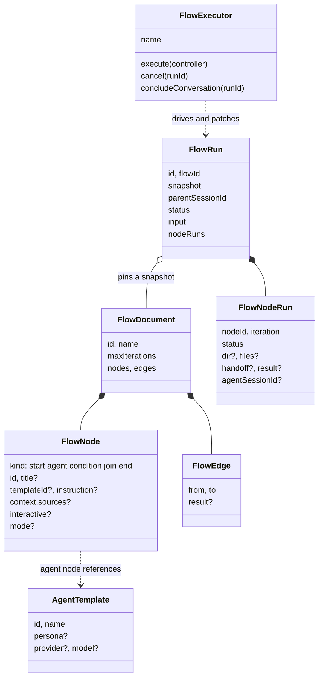
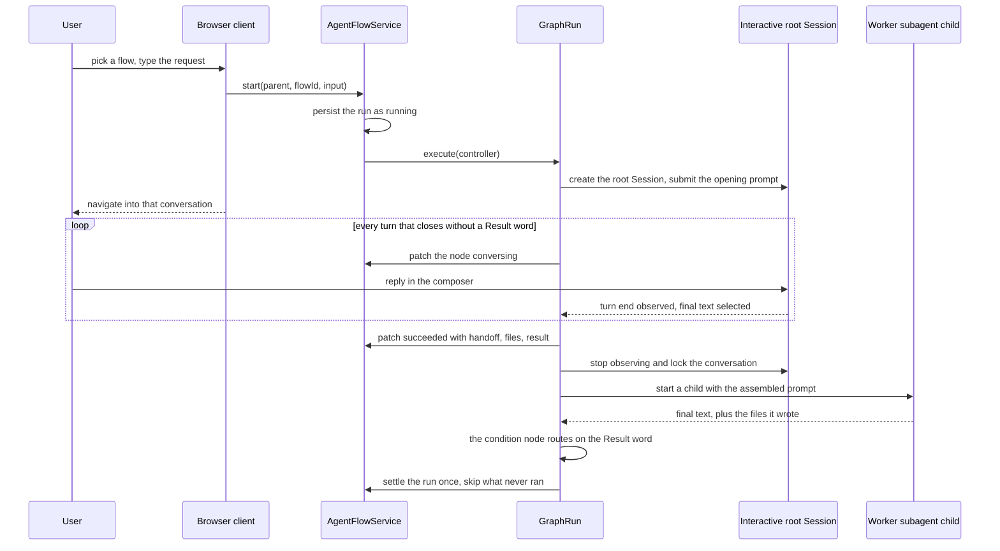
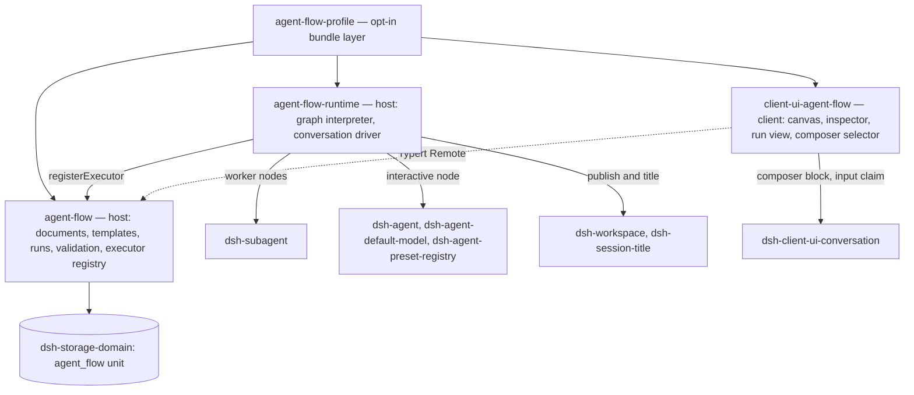
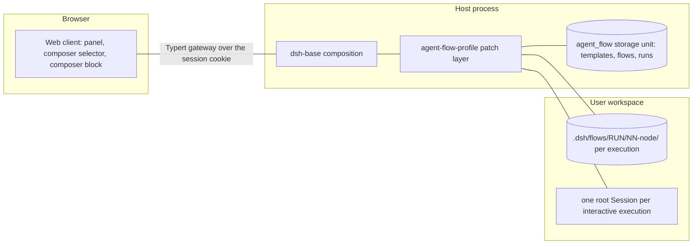

# Agent Note: Agent Flow 设计——文件交接的聊天群工作流

Status: proposed

> **当前权威（2026-10-21 检视决议）。** 最终图词汇与本提案的部分内容不同：每条关系持久化明确的 `execution` 或 `input` 类型；只存在 `all` 汇合；原始用户请求需要显式的 start 输入边；执行边交接其来源任务结果；只接受串行审查回环——一个 agent 入口与一个条件返回——环内并行汇合被拒绝。[Agent Flow 子系统参考](../../../../docs/subsystems/agent-flow.zh.md) 持有当前契约。下方早于该决议的字段草图与段落保留为原始提案。

[English](2026-10-10-agent-flow-design.md) | 中文

## Problem

用户需要固定的多 Agent 工作流：编写一次可复用的 agent 类型，接入路由由用户控制的流程图，并反复执行。M1–M4 骨架（[seams 笔记](../../implemented/architecture/2026-09-24-agent-flow-plugin-seams.zh.md)，包拓扑决策由它持有）证明了这条 seam 可行，但它交付的交接模型把格式与接线工作推给了用户：逐模板的 `outputSchema`、带 `{{…}}` 占位符的手写节点 prompt 模板、读 JSON 路径的分支条件、排除评审循环的无环图，以及从具名变量启动的 run。节点产出的任何东西都不会以文档形式留存。

用户的心智模型是一个成员按固定顺序响应的聊天群。一个 agent 消费两类可选输入——用户的开场消息与上游交接——并像工程师交接工作那样移交：写好文档、留下交接说明、把文件位置指给下一个 agent。评审流程循环到评审通过为止。

## Proposal

在 seams 笔记确立的四个实验包中交付完整的工作流系统：`agent-flow`（storage domain 之上的文档与 run）、`agent-flow-runtime`（`graph` 执行器）、`client-ui-agent-flow`（Web 面板）与 `agent-flow-profile`（选用 bundle）。下面各节是完整的目标设计：功能特性、数据模型、运行时语义、用户界面、约束与接受的限制。M1–M4 交付了骨架；M5 按本设计替换交接模型，分三步走（M5a 数据与运行时、M5b 面板、M5c 输入框工具条选择器）。

## Features

**Agent。** 面板的 Agent 页列出每个 agent 及其被多少个流程引用，一个都没有时提示创建，并在表单中编辑单个 agent：名称、人设，以及从系统已配置目录中选择的模型路由（无自由文本、无默认值）。已保存但目录不再提供的路由保持可选，编辑不会改写它。agent 使用系统默认的工具集，暂时不做逐 agent 限制。

**流程。** 画布为每个流程编辑一张有向图：`start`、`agent`、`condition`、`join`、`end` 节点，拖动连线。agent 节点引用一个模板，并携带一条 `instruction` 和一份选择读取哪些上游交接的 `context`，默认取直接前驱；用户消息恰在有一条来自 `start` 的入边时进入该节点。条件节点的每条出边携带一个路由词。保存时校验一次性拒绝整张图并列出全部问题：唯一的 start 与 end、完全连通、存在一个除 start 外没有其它必然前驱的入口节点、必然激活的边不构成环、条件节点恰由一个 agent 节点接入且每条出边带互不相同的词、一个 agent 最多接一个条件节点、join 至少两条入边、context 来源可解析。

**Run。** run 从聊天页启动：会话输入框左下角工具条中的 workflow 选择器——与「+」菜单和权限模型选择器并排——作用于当前会话，选中 workflow 后发送消息即以该消息为输入启动一次 run。run 保持可取消。运行视图渲染为聊天记录：每次节点执行是一条消息，展示 agent 名、交接说明、可打开的产出文件链接与状态。运行在途时列表自动刷新。

**交接。** 每次 agent 节点执行拥有一个工作区目录，并把文档写入其中。runtime 从文件系统与 agent 的最终消息派生持久记录；下游 agent 收到交接说明与文件路径，按需阅读。

**分支与循环。** 条件节点按唯一接入它的 agent 节点的 `Result: <word>` 行路由：runtime 把词与条件节点的出边精确匹配并激活命中的边。条件节点的每条出边都携带一个词；缺失或不在词汇表中的行会让产出它的 agent 响亮地失败。条件节点自身不产出内容，并把该 agent 的交接转发给自己的目标，因此折返进循环的那条路径依然带着做出这个选择的结论。环上至少经过一个条件节点才被放行，评审循环因此可以运行到评审通过；flow 级迭代上限为循环兜底。

## Data model

`FlowId`、`AgentTemplateId` 与 `FlowRunId` 仍是随机的全局唯一品牌字符串，一次 run 绑定它启动时的完整 flow 文档。

```ts ignore-check
/** One reusable agent definition. */
interface AgentTemplate {
  readonly id: AgentTemplateId
  readonly name: string
  readonly persona?: string
  readonly provider?: string
  readonly model?: string
}

/** One directed workflow graph; every cycle must pass a condition node. */
interface FlowDocument {
  readonly id: FlowId
  readonly name: string
  /** Bound on total agent-node executions per run; validated, default 16. */
  readonly maxIterations: number
  readonly nodes: FlowNode[]
  readonly edges: FlowEdge[]
}

type FlowNode =
  | { readonly kind: 'start'; readonly id: string }
  | {
      readonly kind: 'agent'
      readonly id: string
      readonly title?: string
      readonly templateId: AgentTemplateId
      /** What this step does; the runtime assembles the full prompt. */
      readonly instruction: string
      /** Handoff selection; defaults to the direct predecessors. */
      readonly context?: { readonly sources?: string[] }
    }
  | { readonly kind: 'join'; readonly id: string; readonly mode: 'all' | 'any' }
  | { readonly kind: 'condition'; readonly id: string }
  | { readonly kind: 'end'; readonly id: string }

interface FlowEdge {
  readonly from: string
  readonly to: string
  /** Routing word of one condition-node outgoing edge; absent on every other edge. */
  readonly result?: string
}

/** One run of a flow, started from one user message. */
interface FlowRun {
  readonly id: FlowRunId
  readonly flowId: FlowId
  readonly snapshot: FlowDocument
  readonly parentSessionId: SessionId
  readonly status: 'running' | 'completed' | 'failed' | 'cancelled'
  readonly input: string
  readonly nodeRuns: FlowNodeRun[]
  readonly startedAt: string
  readonly finishedAt?: string
  readonly error?: string
}

/** One execution of one node; an agent node re-executing in a loop adds entries. */
interface FlowNodeRun {
  readonly nodeId: string
  readonly iteration: number
  readonly status: 'pending' | 'running' | 'succeeded' | 'failed' | 'skipped'
  readonly agentSessionId?: SessionId
  /** Workspace directory this execution wrote into. */
  readonly dir?: string
  /** Files found in `dir` after the node settled; derived, never declared. */
  readonly files?: string[]
  /** The agent's final message. */
  readonly handoff?: string
  /** The Result word an agent emitted, or the one a condition node routed on. */
  readonly result?: string
  readonly error?: string
}
```

## Runtime semantics

**调度。** 执行器遍历图：就绪节点在并发上限内运行；条件节点激活其词与上游 agent 的 Result 行匹配的那条出边；join 等待 `all` 全部到达或 `any` 首个到达；不可达节点以 `skipped` 结束。start 只激活它的入口节点——除 start 自身外没有其它必然前驱的节点，条件节点的选择性出边不算前驱——其余的 start 边只是把目标标记为读取用户消息，不会让它抢在给它们排序的前驱之前运行。环以递增的迭代序号重复执行其节点，直到某个条件节点路由出环或 run 达到 `maxIterations`——超限则 run 失败并记录最后一次 result。

**固定 prompt 组装。** 节点 prompt 由 runtime 渲染，用户不再手写模板：instruction；有来自 `start` 的入边时的用户消息；每个 source 节点一节，携带其交接说明与绝对文件清单，从不携带文件内容，其中条件前驱贡献的是接入它的那个 agent 的交接；本节点的产出目录；以及当节点接入一个条件节点时，一行要求最终消息以 `Result: <word>` 结尾的指令，用词取自该条件节点出边的词汇表。

**文件交接。** 每次 agent 节点执行拥有工作区内的 `.dsh/flows/<runId>/NN-<nodeId>/`，NN 是迭代序号。runtime 在节点启动前创建目录，节点结束后扫描目录得到 `files`，并把最终 assistant 文本存为 `handoff`。Result 行从 handoff 的最后一行解析；缺失或不在词汇表中的行会让节点响亮地失败，报错给出期望用词。

**节点 agent。** 模板仍映射到 subagent seam 的启动选项（人设与模型路由），节点执行就是 runtime 的一次 `ctx.subagents.start()` 调用、跑在 run 父会话的子会话里，agent 基座完全不动。节点 agent 使用系统默认的工具集。

**持久化与取消。** 记录仍存放在 `agent_flow` storage-domain 单元，按记录分条布局。run 在执行器开始前以 `running` 状态持久化，在后台恰好结算一次，超过 `maxRuns` 的最旧已结算 run 被丢弃。只有父会话的存活 Agent 可以取消 run；取消会中止在途的节点 agent，且是终态的。本次布局变更提升 domain 版本，M1–M4 构建写入的记录在读取时被丢弃、没有迁移路径；本包是实验性的，没有稳定性承诺。

## User interface

Web 面板保持三个标签页。**Agent** 是默认视图，管理模板。**流程** 列出流程并打开画布编辑器；检查器编辑节点的 instruction 与 context 来源，以及离开条件节点的边的路由词。**运行记录** 把每个 run 渲染成带文件链接、实时状态与取消操作的聊天记录。run 从不从面板启动：输入框左下角工具条中的 workflow 选择器作用于当前会话，选中后发送消息即以该消息为输入启动 run。

## Constraints

- 不修改 agent 基座：不动 agent-loop、会话与 subagent seam；节点 agent 是普通的 subagent 子级。
- 不挤占 PTC 工作流引擎：一个 context 只有一个 `WorkflowEngine` provider，而 Agent Flow 是独立服务。
- 没有面向模型的表面：系统不注册任何工具、不向用户会话注入 prompt、不追加会话事件，因此「模型可见 ⟺ 已记录」不变式不被触发，也不需要 `SessionEventMap` 或 SDK 变更。run 细节存放在 storage domain，而非会话日志。
- 所有包都是实验性、公开且无稳定性承诺；用户通过 `agent-flow-profile` bundle 选用。
- 不增加独立入口：启动 run 复用输入框左下角的工具条，与「+」菜单和权限模型选择器是同一表面。
- 随部署变化的上限（`maxRuns`、`maxIterations`）是经过校验的配置，不是硬编码常量。
- 产物位于用户工作区，可见且可被用户修改。

## Limitations

- 取消是终态；从失败节点继续暂缓，带迭代序号的记录已为此留出空间。
- run 进度按间隔轮询，而非流式推送。
- 环必须经过条件节点；环内 join 的语义未定义，以文档说明而非处理。
- Result 路由依赖模型遵从；失败是响亮的，但会烧掉迭代次数。
- source 很多的深流程会让 prompt 膨胀；默认取直接前驱把规模限制在局部，内容从不内联传输。
- run 的进度与聊天记录在面板中查看；消息与结果不会回流进会话自身的聊天视图。
- 没有模糊路由（用 LLM 判断自然语言条件）；只有精确的 Result 词参与路由。
- domain 版本提升会丢弃 M1–M4 的 flow、模板与 run。

## Delivery plan

M1–M4（已交付）：服务 seam、图执行器、面板与 bundle。M5a 在数据类型与运行时中替换交接模型——instruction 与 context 取代 `prompt`，文件目录与派生记录取代 `outputSchema` 与插值，Result 路由取代 JSON 路径条件，并带来带迭代上限的环。M5b 重塑面板：聊天记录式运行视图与简化后的编辑器，并移除启动器。M5c 通过 `conversation.input.left` 插槽在输入框左下角工具条中加入 workflow 选择器。M6 把路由从 agent 节点的出边移到条件节点，并让 start 入边决定用户消息——在一次 design→implement→review 流程的真实端到端运行之后，逐节点隐藏输入开关与「决策是边的属性」两件事都被证明在画布上读不出来。

## Alternatives considered

平台层面的备选由 seams 笔记持有——第二个 `WorkflowEngine` provider、扩展 Agent Teams、以 preset YAML 编写流程、把 run 记入会话事件——本设计维持这些否决。交接模型的备选如下：

**用 LLM 判断分支条件。** 判断器能容忍模糊措辞，但它给每次路由决策增加成本与延迟、在重放下不确定，并且离开模型就无法测试。Result 约定是确定性的、可持久化的、零成本的；如果将来出现真正模糊的路由，判断器可以作为第二种条件形式回归。

**把路由词挂在决策 agent 自己的出边上。** 这种形态每个决策少一个节点，但它把分支藏进了边的属性：画布上看到一个 agent，它的出边却在悄悄决定这个节点到底做不做决策；一个 agent 的出边集合必须要么全带词要么全不带，于是同一个节点无法既扇出又分支；而需要综合多个上游结论的决策无处安放。条件节点把决策变成图上一等公民，让 agent 节点只做一件事，且运行时零成本——该节点瞬时解析。

**用一个逐节点开关表达用户消息。** agent 节点上的布尔字段能用，但它在画布上不可见，而且重复了图已经说明的事实：`start` 就是用户消息的入口，所以一条来自它的边就是这个事实本身。由这条边推导输入只保留一套机制，代价是需要一条入口规则来防止中途的 start 边让目标提前运行。

**保留逐模板 outputSchema。** 它把格式编写变成每个用户对每个模板的工作，而结构化输出的存在意义主要是让 runtime 能路由——Result 行直接服务这个需求。人可读的结构保留在 runtime 派生的 run 记录里，而不是任何需要 agent 产出的东西里。

**文件存在性条件。** 条件必须判断内容而非存在性；结论本来就在交接说明里，Result 恰好把这份内容提取进记录。

**把 workflow 消息写进父会话。** 这是聊天群模型最彻底的读法，但它会修改 agent 基座约束所保留的会话行为。面板渲染聊天记录作为替代；聊天页选择器启动 run，不碰消息流。

**面板侧 run 启动器。** 带流程与会话选择器的启动器与输入框工具条重复，还会分散入口。workflow 选择器复用该工具条，run 始终绑定当前会话。

**保留具名 flow 入参。** 具名变量属于填表式启动器；聊天群模型只有一条开场消息。如果将来出现表单式启动的需求，多入参可以回归。

**从失败节点继续。** 暂缓而非拒绝：带迭代序号的记录与按迭代划分的目录已经留出空间，cancel 语义保持现状。

## Acceptance criteria

- 一个评审循环——工程师节点、评审节点，以及一个出边为 `Result: 通过` → end、`Result: 不通过` → 工程师的条件节点——从在输入框左下角工具条中选中 workflow 后发送的一条消息启动，迭代到评审通过为止并终止；工程师的第二轮同时读到上游设计交接与经条件节点转发来的评审结论；始终不通过的 run 在 `maxIterations` 处失败，并记录最后一次 result。
- 下游节点的 prompt 只包含交接说明与绝对文件路径；文件存在于工作区目录下，页面刷新后仍能从存储中看到完整的 run。
- 面板把 run 渲染成带文件链接的聊天记录；模板不再携带 `outputSchema`，flow 不再携带 `inputs`，只有条件节点的出边携带 Result 词。
- 保存时校验拒绝不含条件节点的环、没有入口节点的 flow 与非法的 `maxIterations`，并一次列出全部问题。
- prompt 组装变更是模型可见的，因此覆盖节点 prompt 的录制会话快照在同一变更中更新；触及的包保持逐文件 100% 覆盖率。

## Risks

- Result 行依赖模型遵从。失败是响亮的——报错会给出期望词汇表——但无视指令的模型会让 run 失败而非错路由，反复失败会烧掉迭代次数。
- 交接说明是自由文本，source 很多的深流程会让 prompt 膨胀；source 默认取直接前驱把规模限制在局部，文件内容也从不内联传输。
- 环内 join 的语义在无环规则之外未定义；必须经过条件节点的要求让环避开 join，该限制以文档形式说明而非处理。
- domain 版本提升会丢弃 M1–M4 的 flow、模板与 run，没有迁移路径。

## Interactive nodes (M7)

**问题。** 节点 agent 是 run 父 Agent 的 owned child，所以 `ask_user_question` 会以 `DELEGATED_CALLER` 拒绝它（[user-questions](../../../../packages/interaction/user-questions/src/index.ts) 只准入 `agents.roots()`），one-shot 子会话的 Web 输入框是只读的，而 web profile 里所有 subagent 消息工具都是关闭的。真实流程的第一棒——一个挖掘需求的资深工程师——根本没法和用户说话。

**解决它的区分。** root 与 owned child 是*运行时归属*关系，不是持久谱系：`roots()` 的定义是「创建时没有持有它的 agent context……被恢复的 fork 仍然可以是 root」（[agent registry](../../../../packages/core/agent/src/index.ts)）。以普通 Session 形态物化的节点就是 root：它可以问用户，而且它的输入框可写，因为客户端的只读接管是按 `mode === 'one-shot'` 判定的（[ui-subagent](../../../../packages/client/ui-subagent/src/client/index.ts)）。

**决定：对话节点跑在 root Session 上；worker 节点保持 one-shot subagent child。** 只有第一棒面对用户——有疑惑的 worker 该去问它的上游节点，而不是问人——所以两条执行路径换来的是显式的角色划分，而非无意间的分叉。

- 编排：agent 节点上的 `interactive?: boolean`。校验一个流程至多一个，且必须是流程**唯一**的入口节点：start 会一次激活全部入口节点，所以第二个入口会在用户还在澄清时就跑起来。
- 物化：`ctx.agents.create({ sessionId, agentOptions: route, meta: { cwd }, setup })`——`cwd` 是 run 的工作区，`route` 是 `agentDefaultModel.currentSelection()` 叠加模板的 provider/model 覆盖，且路由变更时丢弃继承来的 reasoning effort，与 `resolveChildAgentOptions` 对子 agent 的做法一致。`setup` 通过 `agentPresets.composeFrom` 加入 run 父级的组合，并用 `installModelSelection` 装上该路由；在 agent 平面的组合里，不加入任何 preset 的 root 会看到一个空的工具注册表。不*注册* agent preset：`AgentPresetRegistry.list()` 会把每个已注册定义发布到用户的模式选择器且没有内部标记位，逐模板 preset 会污染它。因此模板的 persona 随组装好的提示词下发，而不是遮蔽系统 persona。随后把该 Session 挂到已持有父会话的那个工作区，并以它的节点命名，于是它像其他会话一样可导航。
- 归属：这个 handle 从不被处置。与 webhook 创建的 Session 一样，该对话是一个寿命长于 run 的普通 Session——处置它会把用户正在阅读的记录从注册表里摘掉，而 M7-4 需要它存活，才能把兄弟节点的提问中继进去。
- 驱动：`agent.followup(...)` 投递组装好的提示词。轮次边界来自观测该 Session 的 `session/event`，并把每个事件折进 `AssistantOutputFold`（subagent 接缝自己的最终输出规则），每遇到一个 `turn/end` 记一条；`whenIdle()` 不是逐轮信号，而同步读日志已被弃用。run 被取消时，`agent.cancel({ kind: 'user' })` 中断正在进行的那一轮。
- 完成是协议，不是生命周期事件。交互节点跨越多轮用户输入保持打开，直到其最终消息带上 `Result: <词>`；不接条件节点的交互节点用固定词 `done`。一轮结束却没有它，意味着对话仍在继续，节点进入 `conversing` 并继续等待。词不在词汇表内会使节点失败，与 worker 一致；reason 为 `error` 的那一轮立即使它失败。提示词把最后这一来回写死：没有遗留歧义时 agent 先问是否可以开始后续工作，只有用户同意才结束澄清，因此下游节点绝不会凭 agent 自己的判断启动。
- 锁定是真的，分两层。客户端对每个「对话节点已进入终态」的会话调用 `ctx.conversation.blocks.set(sessionId, { reason })`——这是官方认可的按会话输入框阻塞，其 reason 会变成不可用输入框的占位文本。它从持久运行名册派生，并且在插件挂载时读取一次而不是只在面板打开时读，因此重载后依然成立，也不需要 session projection。runtime 负责拒绝「某个从未升起该阻塞的客户端仍可能发出」的输入：在对话的 `setup` 里装一个 agent 作用域的 `agent/pre-step` 监听器，拒绝任何携带「非本 runtime 提交的人类提示」的 step，并按 `MessageId` 放行它自己的消息。被拒绝的 step 是静默的——被认领的消息从不进入日志、该轮不带 step 收尾——所以解释由阻塞承担，拒绝只是兜底。`conversation.composer` chain 席位被否决用于此处：它的 `select` 必须是 owner props 的纯函数，因此无法对插件自有的 store 作出反应。
- 两层锁都是客户端或进程本地的。「对话已结束」这个持久事实存在于运行名册里，而 `maxRuns` 最终会淘汰它；一个既能跨重启又能跨淘汰的锁需要 session 事件及其 projection——那是唯一能经 `SessionSnapshot` 反应到每个客户端的路径。
- 边界：`maxConversationTurns`（默认 16）在对话用尽预算仍不收敛时让节点响亮失败。没有等待超时：人类可能离开数小时，而 run 始终可取消，所以一次空闲对话的代价是一个并发槽，而不是一次失败的运行。始终不收敛的对话由 `agentFlows.concludeConversation(parent, runId)` 结束：服务把它转发给拥有该运行的引擎，执行器按 run 保存一个对话 agent（由对话自己 publish 进这个席位），结束时向该 Session 投递一条收尾指令并消费掉这次登记——于是重复请求得到 `agent-flow/not-conversing`，而不是把模型催第二遍。运行继续执行，结束的只是对话。
- 澄清是流程的闸门，而不是流程之前的阶段。面向用户的要求是「资深工程师把需求澄清完，问一句是否开始，之后整个 workflow 才跑」；落地的形态仍然把对话节点作为图的第一个节点，靠三个事实拿到这个体验——它结算前下游无法启动、提示词要求一次明确放行、面板在其节点等待期间把运行显示为「澄清中」。把澄清移出图、变成一个只在确认后才调用 `start` 的前置阶段，已被否决：那样运行记录更干净，但需要另一条通道把设计文档送进运行输入、把节点从画布上拿走，并且丢掉已经跑通的图内交接。
- 启动即跳转：交互节点的会话 id 一落进运行记录，就导航到该 Session，让用户在流程把对话搬去的地方接着谈。
- 交接仍是文档驱动：澄清对话不向下游传递，其成果是 `design.md` 加上该节点的收尾消息。
- 节点间澄清经 runtime 中继，这是兄弟节点唯一的共同枢纽：提问方收尾的 `Ask: <nodeId>` 指名一个祖先，runtime 向该节点的 Session 投递问题并等它那一轮回复，再把答案投回。没有活会话的目标，由一个用「模板 + 它自己的 handoff + 文件路径」重生成的一次性 child 回答。每次问答都记入运行记录。

**已否决。** 逐模板注册 preset（污染选择器）。让任意节点都能与用户对话（worker 的疑惑属于它的上游节点，而且每个节点都开放无界的人类输入会让无人值守的 run 变得无界）。把澄清对话中继回父 Session（一份重复的记录加上双向中继机制）。让第一棒直接跑在父 Session 里（persona 按 agent scope 注册，活会话无法变成那位资深工程师）。

## 设计视图（4+1）

**这个插件是干什么的。** Agent Flow 让用户把一套固定的多 Agent 工作流编写一次——一张流程图，节点指名可复用的 agent——然后从一条普通聊天消息里反复运行它。它存在的理由是：另一个选择（让模型针对每次请求自由编排）无法承诺每次都是同一个形状——评审总会发生、设计文档总会存在、循环总会终止。本插件拥有编写、校验、调度、交接与运行历史；它不拥有任何 agent 行为，因为每个节点 agent 都是经既有接缝触达的普通框架 agent。

### 逻辑视图

五个持久概念加一个接缝。模板是可复用的 agent 定义；文档把模板接成一张图；运行钉住它启动时的文档，并为每次节点执行记一条；执行器接缝让服务把运行交给引擎，而不必知道引擎怎么工作。



一种节点类型背后有两种执行模型，而这个划分是角色划分而不是优化：`interactive` agent 节点物化一个用户可加入的 **root 会话**，因为只有 runtime root 可以向用户提问、也只有 root 保留可写输入框；其余每个 agent 节点作为运行父级的**一次性 subagent 子 agent** 运行，因为它没有可对话的人，也不该获得一个。

### 进程视图

一次运行就是一个 `GraphRun`：一个基于边激活的调度循环，受槽池约束，恰好结算一次。控制节点瞬时结算；agent 节点在整段执行期间占着一个槽。



三个上限让无人值守的运行保持有限：`maxIterations` 限制 agent 执行总次数，`maxConversationTurns` 限制一次澄清对话，`maxConcurrentAgents` 限制并行节点 agent。取消是执行器观测的一个信号：它中止 worker 子 agent、取消交互会话正在进行的轮次，并结束每一次等待。提前结束澄清的范围更窄——它投递一条收尾指令并消费掉登记，运行本身继续执行。

### 开发视图

四个包，一个角色一个，由一个 opt-in bundle 组合。它们之外没有任何东西改变。



运行时内部，四个文件拥有四件事，彼此不越界：`index.ts` 校验配置并注册执行器；`executor.ts` 调度图并委派每个节点；`conversation.ts` 拥有交互节点的 root 会话——创建、发布、轮次观测与锁；`prompt.ts` 组装每份提示词并解析每行 Result。客户端保持平行的纪律：`controller.ts` 拥有 Remote 读取与快照 store，`graph.ts` 拥有草稿编辑辅助函数，`mount.ts` 拥有注册以及输入框认领里那唯一一次启动调用。组件读 store，且只经那一个 `onMutate` 回调修改草稿，因此保存总是发送完整文档。

### 物理视图

一个宿主进程、一个浏览器、一个工作区目录、一个存储单元。



该 bundle 是打在 `dsh-base` 之后的补丁层，因此它只追加三个条目、不配置其它任何东西。它要求 `storageDomain`、`agentFlows`、`subagents`、`agents` 与 `agentDefaultModel`；`workspaceRegistry`、`sessionTitle` 与 `agentPresets` 存在时使用、缺失时降级，因为一个无处发布会话的组合仍然是一次可用的运行。产物落在用户自己的工作区里，可读可改；一次运行的记录能跨重载存活，因为它们是存储而不是内存。

### 场景

四个视图一致，当且仅当下面这些都成立；每一条都有测试或一次真实运行覆盖。

1. **编写。** 用户创建 agent，接出 `start → clarify → implement → review → verdict → {end, implement}`，把 `clarify` 标为交互节点，保存，Host 一次列出全部校验问题。
2. **启动。** 用户在聊天会话里从输入框工具条选中该流程并发出一条消息；运行绑定到该会话，客户端跟随它进入澄清对话。
3. **澄清。** 交互节点跨轮提问，用户在真实输入框里回答，节点只在某一轮以其 Result 词收尾时才结算；它的 `design.md` 与收尾消息是唯一下传的东西。
4. **循环。** 评审的 `Result: needs-work` 经条件节点路由回去，条件节点转发评审自己的交接，于是第二轮实现同时读到设计与结论；`approved` 路由出去。
5. **停止。** 用户提前结束澄清，或取消运行；前者让流程继续，后者结算运行并跳过所有未到达的节点。
6. **回到现场。** 重载后运行从存储完整读回，已结束对话的输入框仍然是阻塞的。

## 设计原则

本插件必须满足的仓库既有规则，以及专为它做出的选择。

**继承自 harness。**

- **插件，而不是改循环。** agent 底座未被触碰：任何一期都没有改动 agent-loop、session 或 subagent 接缝的行为。每项能力都经一个有文档的接缝到来——worker 节点走 subagent 接缝，交互节点走 agent 注册表，引擎走执行器注册表，面板与输入框选择器走槽位，锁走 `ctx.conversation.blocks`。四个包之外确实改动的是注册行与生成行：opt-in bundle 列表、发布 family、第三方声明，以及重新生成的目录。
- **接缝要么完整，要么不是接缝。** `FlowExecutor` 把定义、唯一 provider 与消费者放在一起；服务从不了解引擎如何工作，引擎也从不了解运行如何存储。
- **包边界上显式优于隐式。** 提示词组装是一个具名函数对一个具名输入记录。执行路径里没有任何东西默认发生。
- **配置错误响亮失败，且在最早能看到它的地方。** 一次保存校验整张图并报告全部问题；未知的 Result 词让节点失败并指名词汇表；空的执行器名在加载时失败。
- **随部署变化的选择是经校验的配置。** `maxRuns`、`maxIterations`、`maxConcurrentAgents` 与 `maxConversationTurns` 都是带默认值的配置字段，绝不是常量。
- **先复用有维护的接缝，再考虑自己写。** 最终助手输出的选取用的是 subagent 接缝自己的 fold；父级组合的 join、模型选择的安装、branded id 与输入框阻塞，全都是既有框架机制而不是新造的。
- **模型可见即已记录——所以干脆不上模型可见面。** 本插件不注册工具，也不追加任何属于自己的会话事件；它提交的提示词只进入它自己创建的 Session。运行细节住在存储 domain 里，这正是为什么 `SessionEventMap` 成员与 SDK 期望输出从未需要改动。

**为本插件选择的。**

- **交接是文档，不是 schema。** agent 把文件写进运行时指名的目录；运行时扫盘派生记录。用户从不编写输出格式、提示词模板或 JSON path，因为那是把格式工作推给一个只想要工作流的人。
- **路由是确定性的。** 条件节点用一个精确词匹配它的出边。没有裁判、没有额外模型调用、重放下没有不确定性——而一个不靠模型就无法测试的决策，就是一个不会被测试的决策。
- **图上说的就是画布上看到的。** 用户消息由「有一条边到达 `start`」派生，而不是一个隐藏的逐节点开关；决策是一个节点而不是一个边属性；与用户对话的那个节点带着可见标记。作者在画布上看不见的机制，就是他一定会用错的机制。
- **一个节点一个角色。** 节点要么产出内容要么路由；恰好一个节点面对用户。有疑惑的 worker 去问它的上游节点，而不是问人，因为每个节点都开放无界的人类输入会让无人值守的运行变得无界。
- **运行时调度 agent，它自己不变成 agent。** 没有第二个 agent 循环、没有第二套 harness、没有重新实现的工具组合——交互节点加入运行父级的组合，因此它拿到的是用户自己 agent 所拥有的同一套工具与系统提示词。
- **对一次运行的权限属于启动它的会话。** 取消与结束澄清都解析父级的活跃 Agent；来自别的会话的调用方得到 not-found，而不是一个暴露该运行存在的拒绝。
- **响亮失败，安静降级。** 缺失必需服务在加载时失败。缺失可选服务——没有工作区可发布、没有标题服务、没有 preset 名册——降级为一次可用的运行，因为它们对执行都不是承重的。
